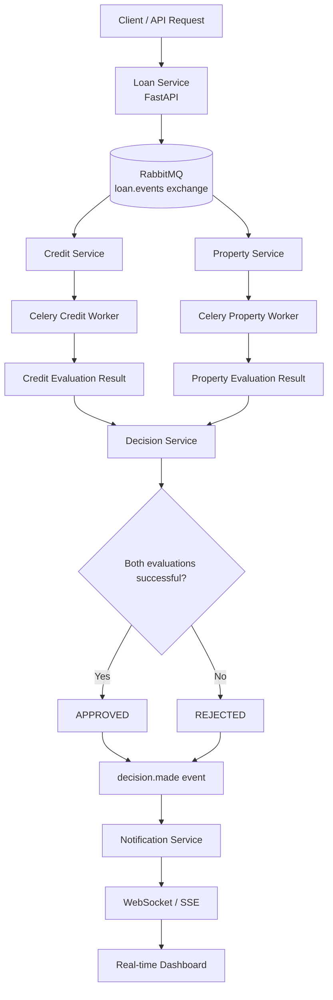

# 🏦 Loan Application Evaluation System

An event-driven microservices application designed to automate the evaluation of loan applications through independent credit assessment, property evaluation and centralized decision-making services.

Built with Python, FastAPI, RabbitMQ and Celery, the system demonstrates asynchronous communication, distributed task processing and real-time decision notifications.

## System Architecture



## Application Workflow

### 1. Loan Application Submission

**Loan Service · FastAPI**

- Exposes a REST API to receive loan applications.
- Validates application data using Pydantic.
- Generates a unique loan identifier.
- Publishes a `loan.created` event to RabbitMQ.

### 2. Asynchronous Event Distribution

**RabbitMQ · AMQP**

RabbitMQ acts as the central message broker.

- Uses a topic exchange named `loan.events`.
- Distributes loan creation events to the relevant services.
- Decouples application submission from downstream evaluation.
- Uses correlation IDs to associate events with the same loan application.

### 3. Credit Evaluation

**Credit Service · Celery**

- Consumes loan creation events.
- Dispatches background evaluation tasks through Celery.
- Simulates credit score generation.
- Publishes either `credit.checked` or `credit.failed` events.

### 4. Property Evaluation

**Property Service · Celery**

- Independently consumes loan creation events.
- Dispatches property evaluation tasks.
- Calculates a simulated property value.
- Publishes `property.evaluated` or `property.failed` events.

### 5. Centralized Decision Making

**Decision Service · FastAPI**

The decision service coordinates the results of both evaluations.

- Receives credit and property evaluation events.
- Associates results using the loan correlation ID.
- Waits until both successful evaluation results are available.
- Approves the application if both checks pass.
- Rejects the application if either check fails.
- Publishes a `decision.made` event containing the decision and its reasons.

The implementation also includes failure handling and compensation events.

### 6. Real-time Notifications

**Notification Service · FastAPI**

- Consumes decision events from RabbitMQ.
- Broadcasts decision updates to connected clients.
- Supports WebSocket connections.
- Supports Server-Sent Events (SSE).
- Provides a lightweight real-time loan status dashboard.

## 🛠️ Technology Stack

| Category | Technologies |
|---|---|
| Programming | Python 3.11 |
| API Framework | FastAPI |
| Data Validation | Pydantic |
| Message Broker | RabbitMQ |
| Messaging Protocol | AMQP |
| Background Processing | Celery |
| Real-time Communication | WebSockets, SSE |
| ASGI Server | Uvicorn |
| Containerization | Docker |
| Orchestration | Docker Compose |

## Project Structure

```text
Implementation-du-Processus-evaluation-des-Demandes-de-Pret/
│
├── services/
│   ├── loan/
│   │   ├── app/
│   │   └── Dockerfile
│   │
│   ├── credit/
│   │   ├── app/
│   │   └── Dockerfile
│   │
│   ├── property/
│   │   ├── app/
│   │   └── Dockerfile
│   │
│   ├── decision/
│   │   ├── app/
│   │   └── Dockerfile
│   │
│   └── notification/
│       ├── app/
│       └── Dockerfile
│
├── shared/
│   ├── schemas.py
│   ├── constants.py
│   └── messaging.py
│
├── docs/
│
├── docker-compose.yml
└── requirements.txt
```

## Getting Started

### Prerequisites

- Docker Desktop
- Docker Compose

### 1. Clone the repository

```bash
git clone https://github.com/FellatiZineb/Implementation-du-Processus-evaluation-des-Demandes-de-Pret.git

cd Implementation-du-Processus-evaluation-des-Demandes-de-Pret
```

### 2. Start the application

```bash
docker compose up --build -d
```

### 3. Check running containers

```bash
docker compose ps
```

### 4. Access the services

| Service | Local URL |
|---|---|
| Loan Service API | http://localhost:8000 |
| Credit Service API | http://localhost:8001 |
| Property Service API | http://localhost:8002 |
| Decision Service API | http://localhost:8003 |
| Notification Dashboard | http://localhost:8004 |
| RabbitMQ Management | http://localhost:15672 |

FastAPI interactive documentation:

- Loan: http://localhost:8000/docs
- Credit: http://localhost:8001/docs
- Property: http://localhost:8002/docs
- Decision: http://localhost:8003/docs
- Notification: http://localhost:8004/docs

RabbitMQ management credentials for the default local configuration:

`guest / guest`

### 5. Submit a loan application

Example request:

```bash
curl -X POST http://localhost:8000/loans \
  -H "Content-Type: application/json" \
  -d '{
    "client_id": "CLIENT001",
    "amount": 100000,
    "property_id": "PROPERTY001"
  }'
```

The API returns a generated loan ID.

The evaluation process then runs asynchronously through the different services.

### 6. Monitor the decision

Open:

http://localhost:8004

The notification dashboard supports both WebSocket and Server-Sent Events connections to display decision updates.

## Evaluation Logic and Limitations

This project is an educational microservices implementation. Its evaluation mechanisms are simulated rather than connected to real financial institutions or credit bureaus.

| Component | Current implementation |
|---|---|
| Credit evaluation | Random score generated between 300 and 900 |
| Credit threshold | Score below 600 triggers rejection |
| Property evaluation | Simulated value calculated as 1.2 × loan amount |
| Decision | Approved when both evaluation checks pass |
| Application storage | In-memory Python dictionaries |
| Notifications | WebSockets and Server-Sent Events |

The application demonstrates the architecture and communication patterns of a distributed loan evaluation workflow. It is not intended for real-world credit decisions.

## Key Engineering Concepts

- Microservices architecture and service separation.
- Event-driven communication using RabbitMQ.
- Asynchronous background processing with Celery.
- REST API development with FastAPI.
- Event correlation and distributed workflow coordination.
- Centralized decision orchestration.
- Failure handling and compensation events.
- Real-time updates using WebSockets and SSE.
- Containerized deployment with Docker Compose.

## Authors

**Zineb Fellati** and project collaborators.

M2 DataScale — Université de Versailles Saint-Quentin-en-Yvelines.

Academic project.

---

⭐ Explore the repository to discover the implementation of each microservice.
